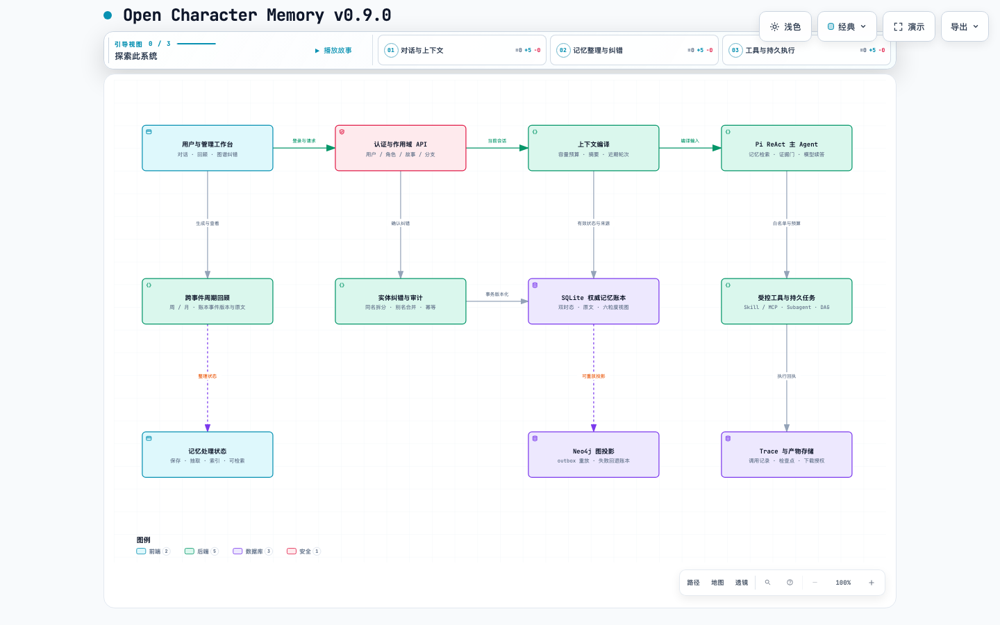

# Open Character Memory

[English](README.en.md) | [中文](README.md) | [Apache-2.0](LICENSE)

Open Character Memory is an open-source role-user memory runtime and visual studio for role-play companions and tutoring agents. It remembers user facts, character commitments, shared stories, corrections, relationship state, and narrative branches without treating every semantically similar memory as current truth.

Version `0.10.0` combines a Pi Agent Core ReAct loop and persistent Plan-Execute Deep Agent with multi-granularity, corrective, and agentic memory retrieval, a bitemporal SQLite source of truth, replayable Neo4j fact/semantic graph projections, and controlled Skill/MCP execution.

Version `0.10.0` keeps bounded parallel Subagents for work that should finish inside the current turn and adds a durable cross-request DAG runtime for long work. Model-proposed plans are validated and persisted by the server, then executed by an independent leased Worker with checkpoints, human approvals, bounded replanning, and reconciliation for uncertain non-idempotent writes.



[Open the interactive architecture diagram](docs/memory-lifecycle-v0.9.architecture.html)

## Highlights

- Bidirectional user, character, and shared-story memory with strict user/agent/story/branch isolation.
- Evidence-backed standalone facts, preferences, current/planned states, and character utterances with distinct `explicit`, `assistant_utterance`, `accepted`, and `inferred` semantics.
- Event operations for `create`, additive `enrich`, real-world `update`, belief correction `supersede`, and `retract`, backed by valid and transaction time.
- Six rebuildable retrieval views per canonical event, entropy-aware routing, semantic associations, bounded PPR, pre-answer corrective retrieval, and in-generation read-only memory tools.
- Configurable structured fields, extraction cadence, prompts, retrieval policy, plots, and low-code triggers.
- Scope-locked `memory_search` / `memory_expand`, controlled Skill/MCP exposure, execution receipts, and Pi `toolResult` continuation turns.
- Intent-gated sandboxed file, document, Bash/Python/Node tools plus context-isolated parallel Subagents whose results return to the parent model.
- Persistent Deep Agent runs with validated DAGs, checkpoint resume, worker leases, human approval, cancellation, bounded plan replacement, and side-effect receipts visible in Trace.
- Inspectable Trace views for prompts, injected memory, retrieval evidence, model/tool calls, and post-turn writes.
- A headless `memory-runtime/v1` contract with `observe / recall / expand / mutate / forget`, a persistent extraction queue, a typed JavaScript/TypeScript SDK, Pi and generic adapters, and a read-only MCP server.

## Market comparison

See the [2026 agent-memory comparison](docs/market-memory-comparison-2026.md) for a current review of TencentDB Agent Memory, Mem0, Zep/Graphiti, Letta, LangGraph, Hindsight, and the repository-memory approaches used by Codex, Claude Code, and Cursor. The report includes dated GitHub popularity and market-scale signals, plus an English executive summary.

## What is implemented

- Activity-driven background memory consolidation creates source-linked topics, open items, and reviewable repair proposals. New completed dialogue gates each batch. Defaults are 15 minutes of idle time, 24 new turns, a 24-hour maximum wait, and a one-hour cooldown. SQLite leases, fixed source snapshots, bounded retries, and fenced commits coordinate the work. Entity repairs require confirmation, and fresh derived topics can be read through `memory_search`.
- Hard isolation by user, agent, story, and branch.
- Admin-defined structured memory fields with types, scopes, constraints, extraction instructions, and prompt templates.
- User-defined persistent response rules that pass server-side safety boundaries.
- Versioned claims with additive `enrich` plus `active`, `superseded`, and `retracted` states.
- Bitemporal `valid_*` and `transaction_*` intervals with `valid_at` / `known_at` as-of queries.
- Neo4j fact and semantic-association graph projections with scope keys, idempotent replacement, outbox replay, and SQLite fallback.
- Pi Agent Core state, lifecycle events, and a ReAct-style tool loop. Read-only memory tools are routed only for memory-relevant turns and cannot accept client/model scope keys. Unlocked scoped props are exposed separately; validated declarative Skill tools and allowlisted MCP tools execute through the server gateway and return `toolResult` before the model continues.
- File and command tools use deterministic intent routing before model choice. Routine role-play turns see no sandbox tools. Production accepts only an external OpenSandbox control plane; uploads enter read-only `input`, generated files stay under `output`, and downloadable artifacts retain user, agent, conversation, Trace, and optional subagent scope.
- `delegate_parallel_tasks` can dispatch independent work to `researcher`, `analyst`, `writer`, `verifier`, or `general-purpose` child agents. Defaults are four tasks, three concurrent workers, and depth one. Children receive a reduced context, cannot recurse, and use scoped tool profiles and output directories. Chat streaming and Trace expose live task, sandbox-run, and artifact status.
- `start_durable_workflow` is exposed only for multi-stage, long-running, approval-gated, or resumable work. The model proposes the objective, nodes, dependencies, and risk class; the server owns cycle validation, scope, and budgets. Safe expired leases are resumed from persisted state, while uncertain non-idempotent writes enter `reconciling` instead of being retried blindly.
- User memory plus role/user shared-story events, entities, claims, and evidence-backed relations.
- Post-turn extraction uses two focused model calls in parallel: one for structured fields and the event graph, and one for standalone semantic state. A server-side atomic evidence guard fills explicit titles/names, completed monetary transactions, and current/planned location states when a model omits them; it also preserves concrete methods, options, or recommendations from numbered character utterances. New current locations use a canonical slot and supersede prior values, while planned targets stay separate. Recommendations, budgets, and hypothetical prices cannot become completed transactions. Every guarded claim remains linked to its source message; character utterances stay provisional and cannot masquerade as user facts. The server validates evidence, retries malformed JSON once, merges both outputs, and keeps the extraction checkpoint unchanged on failure.
- Explicit preferences need one direct user message; only inferred preferences require at least two user messages. Assistant-only information remains a provisional shared-story utterance usable for "what did you say" recall, then upgrades across extraction cycles only after user acceptance.
- Clause-level temporal guards correct both directions of current/planned model errors inside mixed sentences, preserve complete nested locations, and keep an explicit target action from being rewritten by an unrelated "currently" continuation. Current-state recall includes only the most relevant planned-transition band, so the answer can distinguish the last confirmed value from a pending target without injecting unrelated plans. Relative expressions retain their source text and are resolved against the source-message timestamp.
- Each canonical event is projected into `turn`, `event`, `claim`, `episode`, `summary`, and `entity_keyword` views. These are rebuildable indexes, never independent truth records.
- An entropy-aware router supports fixed, shadow, dynamic, and stable scope-level A/B modes. Semantic associations are selected with an adaptive GMM threshold, then bounded PPR can expand candidates within at most two hops and 240 nodes.
- A Corrective Recall Planner can rewrite or decompose an insufficient query and search both all active events and standalone claims in the server-locked scope. Its rewritten queries also retrieve embedded preferences and state claims. The main model can later call `memory_search` or `memory_expand` when it discovers an evidence gap.
- Broad personalization queries close over confirmed profile claims inside an adaptive relevance band. Time-bounded count questions use a deterministic server-side reducer over active events and a Runtime-owned response contract, bypassing main-model counting and preventing out-of-range additions.
- An optional post-Planner LLM filter can only propose deletions from already selected events. The server restores direct evidence, relationship evidence, ordered timeline members, and the configured minimum; malformed output or insufficient evidence keeps the complete set.
- A hybrid graph ontology: six broad entity classes, controlled core relation families, preserved concrete predicates, and open traceable extensions. First-person relational queries resolve the current user identity before traversing family, ownership, and evidence edges.
- Deterministic relationship retrieval emits a grounded answer contract containing the user anchor, requested relation family, resolved object, and active evidence edge. Conflicting historical assistant answers are excluded from that model turn, and the decision is visible in Trace.
- Conditional story unlocking and auditable function calls driven by structured state.
- Role prompt, memory injection, six-view entropy/weights, semantic edges, PPR budgets, filter proposals, planner rewrites, cross-pool hits, scope-locked memory tool calls, model usage, and cache diagnostics in Trace.
- Read-only "no short-term memory" Trace replay: rerun the original query in the same scope while giving both the retrieval planner and main model zero recent dialogue messages. The diagnostic run writes only a new Trace and cannot persist messages or memory, fire triggers, advance plots, or execute Skill/MCP tools.
- Provider adapters for Ark, OpenAI, Anthropic, and an offline Mock mode.
- Stable-prefix caching: role instructions and fixed attributes are cacheable; server time, user state, retrieved memory, plots, and recent dialogue stay dynamic. A zero provider-managed `cached_tokens` value means the upstream reported no hit or no cache usage, not that a local cache failed.
- NDJSON chat streaming with turn resets for multi-step tool loops, plus sanitized GFM Markdown rendering. Routine memory-extraction start/completion stays silent and the completion event refreshes the progress ring directly.

## Quick start

Node.js 24 or later is required.

```bash
npm ci
npm run start:mock
```

Open `http://127.0.0.1:4173`. Mock mode requires no external account and uses `local-demo-admin-2026` as a local-only administrator password.

For a real provider:

```bash
cp .env.example .env.local
# Set TEXT_PROVIDER, EMBEDDING_PROVIDER, provider credentials, and a strong ADMIN_PASSWORD.
npm start
```

Docker Compose deliberately requires an explicit administrator password:

```bash
ADMIN_PASSWORD='replace-with-a-strong-secret' \
NEO4J_PASSWORD='replace-with-a-different-strong-secret' \
docker compose up --build
```

The application Compose file does not bundle an OpenSandbox control plane. Keep `SANDBOX_RUNTIME_ENABLED=false` until one is deployed, its sandbox image is built, and the server-side connection variables are configured. See [Sandbox, parallel Subagents, and the Deep Agent Runtime](docs/sandbox-subagent-runtime.md).

Local development defaults to an inline worker. Production separates the web process from durable execution: set `DEEP_AGENT_WORKER_MODE=external`, run `npm run worker:deep-agent`, or use the supplied systemd/Compose worker service. The validated DAG, lease, checkpoint, approval, replan, and side-effect reconciliation contracts are documented in [Persistent Deep Agent Runtime](docs/deep-agent-runtime.md).

## Conversation continuity and memory care

Conversation history uses an estimated 6,000-token budget, recent complete turns, and persisted auxiliary summaries with source fingerprints and message watermarks. Summary failures retain uncompressed source messages. Deterministic fact answers and diagnostic replay bypass summaries.

Weekly/monthly reviews bind active event versions and source evidence. Source changes mark a review stale. The graph inspector provides scoped entity merge/split with versioned corrections, audit records, idempotency and replayable projections. Logged-in users can operate on their own memory. Readiness distinguishes stored messages, extraction backlog, search indexes and graph projection state.

## Headless Memory Runtime

Existing Studio routes remain unchanged. Other agents can integrate through the versioned HTTP contract or the repository SDK:

```js
import { MemoryClient } from '@open-character-memory/sdk';

const memory = new MemoryClient({
  baseUrl: 'http://127.0.0.1:4173',
  apiKey: process.env.MEMORY_SERVICE_API_KEY
}).scope({
  tenantId: 'default',
  subjectId: userId,
  agentId,
  spaceId: storyId,
  branchId: 'main'
});

const contextPack = await memory.recall({ query: userText });
await memory.observe({
  idempotencyKey: turnId,
  threadId,
  extractionMode: 'async',
  messages: [
    { role: 'user', content: userText },
    { role: 'assistant', content: assistantText }
  ]
});
```

The service key is restricted to `/v1/memory/*`. Model-facing tools are read-only and receive no scope arguments; the application injects and locks scope on the server side. See [the headless runtime and SDK contract](docs/headless-memory-runtime.md) and [the OpenAPI document](openapi/memory-v1.yaml).

## Verification

```bash
npm test
npm run eval
npm run check:open-source
```

Tests and memory evaluations run without external model calls.
With real text and embedding providers configured, `npm run eval:long-term:real` reruns the cross-session trip-ordering and pet-care timeline cases. Each fact is seeded in a separate conversation and the final question keeps only its current message, so this command consumes real provider quota and measures long-term memory rather than short-term context.

## Cache boundary

The database, state machine, and prompt compiler remain the only source of truth. The cache stores only a provider context identifier for the stable prompt prefix. Its key contains the provider/model, agent, profile version, scene configuration version, and stable prompt hash. Any profile edit creates a new key. Cache failure falls back to a complete uncached request and never changes memory correctness.

Ark defaults to provider-managed caching reported by Responses usage. Explicit `common_prefix` Context caching remains opt-in for deployments configured with a compatible endpoint ID. Tool-bearing turns use Pi's native provider stream; adapter and native paths both preserve real usage and cache statistics. OpenAI reports provider-managed cached token usage. Anthropic marks the stable system block as ephemeral cache content.

## Storage boundary

SQLite is the current single-node source of truth. `memory_views` and `memory_associations` are rebuildable search projections. Neo4j projects both evidence-backed fact edges and `ASSOCIATED_WITH` semantic edges for traversal, but is not a second authority. Embeddings remain JSON vectors scored in the application process. The JavaScript/TypeScript SDK and persistent single-node extraction jobs are implemented as an alpha workspace package; independent npm/PyPI publication, a Python SDK, PostgreSQL plus pgvector, and a distributed worker remain future work.

OpenSearch may become useful later as a hybrid lexical/vector retrieval index for large corpora, but it should not replace the transactional record or Neo4j path projection.

See [the multi-granularity retrieval design](docs/multigranularity-memory-retrieval.md), [the runtime and graph design](docs/bitemporal-neo4j-pi-runtime.md), [the headless memory contract](docs/headless-memory-runtime.md), [the future storage roadmap](docs/future-storage-sdk-roadmap.md), and [the release checklist](docs/open-source-release-checklist.md).

## License

Apache License 2.0.
